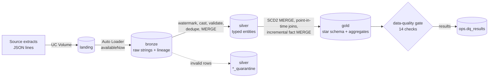
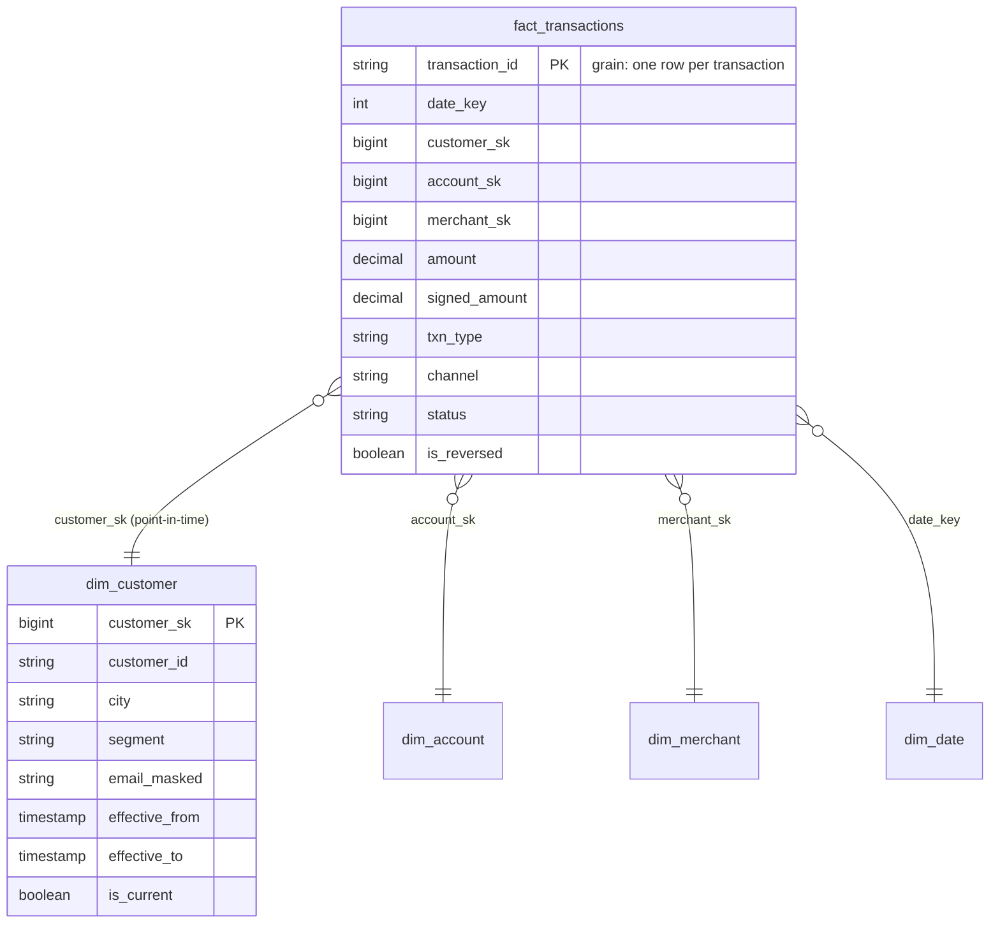

# Finance Analytics Lakehouse on Databricks (Medallion Architecture)

[](https://github.com/LakheraSumer/Finance-Analytics-Engineering-Platform/actions/workflows/ci.yml)

An end-to-end **bronze → silver → gold** lakehouse for retail-banking transactions, built with **PySpark, Delta Lake,
Auto Loader, Unity Catalog and Databricks Workflows** (deployed as a Databricks Asset Bundle). The gold layer is a
Kimball **star schema** with an **SCD Type 2** customer dimension, and every run ends with a **data-quality gate**.

The source data is synthetic but deliberately messy - duplicates, malformed amounts and timestamps, late-arriving
records, status updates (reversals) and customer attribute changes - so each layer has real work to do.



## What each layer does

| Layer | Tables | Key techniques |
|---|---|---|
| **Bronze** | `finance_bronze.{customers, accounts, merchants, transactions}` | Auto Loader with checkpoint (only new files), raw string schema, `_source_file` / `_ingested_at` / `_ingest_run_id` lineage |
| **Silver** | `finance_silver.{entity}`, `finance_silver.{entity}_quarantine` | Incremental by watermark, `try_cast` typing, 3 timestamp formats, standardisation, validation rules with `reject_reason`, latest-version de-duplication (window), idempotent Delta `MERGE` |
| **Gold** | `dim_customer` (SCD2), `dim_account`, `dim_merchant`, `dim_date`, `fact_transactions`, `agg_monthly_category_spend`, `agg_customer_monthly_cashflow` | Single-MERGE SCD Type 2, deterministic surrogate keys (`xxhash64`), point-in-time customer key on `txn_ts`, unknown member (-1), incremental fact `MERGE`, PII masking |
| **Ops** | `finance_ops.pipeline_watermarks`, `finance_ops.dq_results` | Step watermarks for incremental loads; data-quality history |

### Gold star schema



## Engineering decisions

- **Idempotent by design.** Bronze skips files it has already loaded (Auto Loader checkpoint; `_source_file` anti-join
  locally), silver and gold use `MERGE` that only applies *newer* versions, and watermarks advance only after a step
  succeeds. Re-running any step with no new data changes nothing - this is asserted in the tests.
- **Bad data is quarantined, not dropped.** Nine validation rules on transactions (missing keys, unparseable or
  non-positive amounts, invalid or future timestamps, unknown transaction types, channels or statuses) route rows to
  `*_quarantine` with a reason.
- **SCD Type 2 in one MERGE.** Changed customers are staged twice: once keyed on the business key to expire the current
  row, once with a NULL merge key so the new version is inserted. Facts pick the customer version that was valid at
  the transaction time, so spend is attributed to the city a customer lived in *then*.
- **Quality gate before consumers.** 11 blocking checks (keys, uniqueness, referential integrity, SCD2 integrity,
  silver-to-gold row and amount reconciliation) and 3 warnings (unknown merchants, quarantine rate, freshness). A
  failure stops the job and every result is kept in `finance_ops.dq_results`.
- **Governance.** Raw PII stays in restricted silver tables; gold exposes only masked email and the last 4 digits of
  the phone number.

## Run it on Databricks (Free Edition works)

1. **Workspace → Create → Git folder**, paste this repository's URL.
2. Run the notebooks in `notebooks/` in order (`01` → `05`) with widget `batch = 1`, then run them again with
   `batch = 2` to see the incremental load, SCD2 changes and reversals flow through.

Or deploy the scheduled job with the [Databricks CLI](https://docs.databricks.com/dev-tools/cli/):

```bash
databricks bundle deploy
databricks bundle run finance_lakehouse --params batch=1
databricks bundle run finance_lakehouse --params batch=2
```

Then explore the results with [`sql/gold_analysis.sql`](sql/gold_analysis.sql).

## Run it locally

Needs Java 17 and Python 3.11.

```bash
pip install -r requirements-dev.txt
PYTHONPATH=src python -m finance_lakehouse.run_local
pytest -v
```

Locally the same code runs on open-source Spark + Delta Lake; the only difference is that bronze uses a batch read
instead of Auto Loader (a Databricks-only feature).

## Tests

`tests/test_pipeline.py` runs the full pipeline on local Spark + Delta and asserts:

- batch 1: every valid transaction lands in the fact table exactly once; quarantine and de-duplication counts match
  what the generator injected
- re-running with no new files leaves every silver and gold table unchanged (idempotency)
- batch 2: late arrivals and new transactions are added, reversals update existing facts, each changed customer gets
  exactly one new SCD2 version, and facts before/after a change point to the correct customer version
- all blocking data-quality checks pass

CI runs the suite on every push (GitHub Actions, Java 17).

## Project layout

```
databricks.yml                     # Databricks Asset Bundle
resources/finance_lakehouse_job.yml  # Workflow: generate -> bronze -> silver -> gold -> quality gate
notebooks/                         # one thin notebook per task
src/finance_lakehouse/
    data_generator.py              # deterministic synthetic source data with injected issues
    bronze.py  silver.py  gold.py  quality.py
    delta_utils.py                 # MERGE upsert + watermarks
    pipeline.py  run_local.py  spark.py  config.py
sql/gold_analysis.sql              # example analytics queries
tests/
```

## License

MIT
